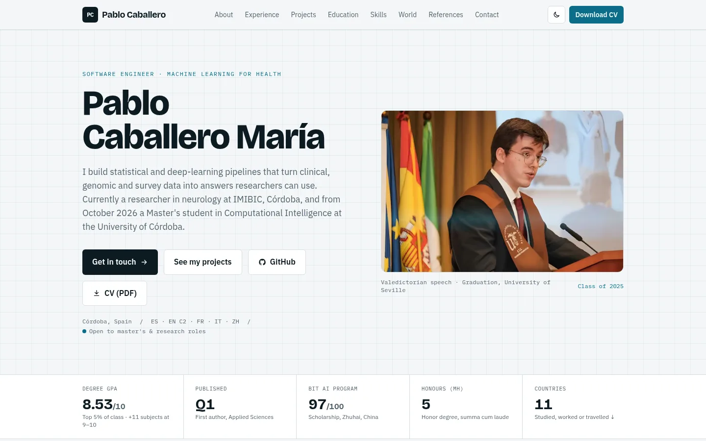
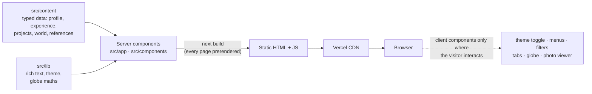
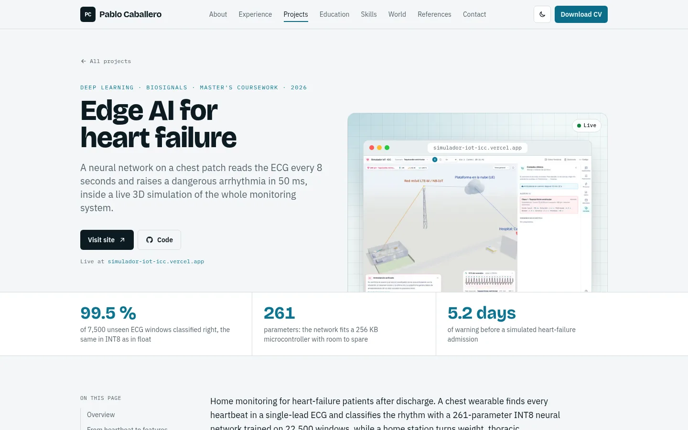
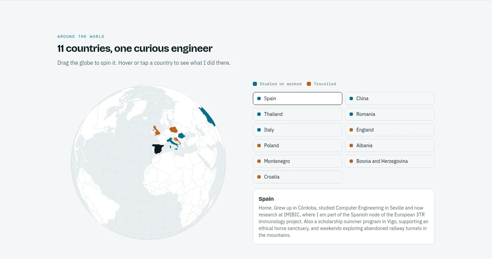
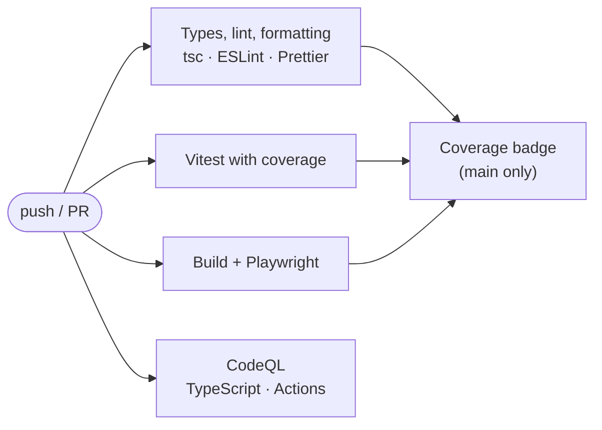

<div align="center">

# Pablo Caballero — Portfolio

**My portfolio and CV**: a Next.js site, statically generated and deployed on Vercel.

[](https://github.com/Pablo-Caballero-Maria/pablo-portfolio/actions/workflows/ci.yml)
[](https://github.com/Pablo-Caballero-Maria/pablo-portfolio/actions/workflows/codeql.yml)
[](https://github.com/Pablo-Caballero-Maria/pablo-portfolio/actions/workflows/ci.yml)
[](https://github.com/Pablo-Caballero-Maria/pablo-portfolio/releases)
[-blue>)](LICENSE)
[](https://pablo-portfolio-woad.vercel.app)


[**Visit the site**](https://pablo-portfolio-woad.vercel.app) ·
[Wiki](https://github.com/Pablo-Caballero-Maria/pablo-portfolio/wiki) ·
[Changelog](CHANGELOG.md) ·
[CV (PDF)](public/Pablo_Caballero_CV.pdf)

<picture>
  <source media="(prefers-color-scheme: dark)" srcset="docs/img/home-dark.webp">
  
</picture>

</div>

Every push to `main` deploys to production; every other branch gets a preview deployment.

- **Home page** (`/`): about, experience, projects, education, skills, an interactive globe of the countries I've
  lived and worked in, photos, references and contact.
- **Project documentation** (`/projects/<slug>`): one page per project, with how it works, figures and results.
  Three are live web apps (sinophile, ESP32 Piano and Edge AI for heart failure, a neural network on an ECG wearable
  inside a 3D simulator), with links to the deployed sites; two are data-analysis coursework that runs locally
  (molecular activity prediction, Milan CDR).

| Project                                                                                              | Kind                                  | Live site                                                            | Repository                                                                      |
| ---------------------------------------------------------------------------------------------------- | ------------------------------------- | -------------------------------------------------------------------- | ------------------------------------------------------------------------------- |
| [sinophile](https://pablo-portfolio-woad.vercel.app/projects/sinophile)                              | web app · personal project            | [sinophile.vercel.app](https://sinophile.vercel.app)                 | [sinophile](https://github.com/Pablo-Caballero-Maria/sinophile)                 |
| [ESP32 Piano](https://pablo-portfolio-woad.vercel.app/projects/piano)                                | IoT · university project              | [piano-web-virid.vercel.app](https://piano-web-virid.vercel.app)     | [piano](https://github.com/Pablo-Caballero-Maria/piano)                         |
| [Edge AI for heart failure](https://pablo-portfolio-woad.vercel.app/projects/heart-failure-ai)       | deep learning · biosignals · Master's | [simulador-iot-icc.vercel.app](https://simulador-iot-icc.vercel.app) | [simulador-iot-icc](https://github.com/Pablo-Caballero-Maria/simulador-iot-icc) |
| [Molecular activity prediction](https://pablo-portfolio-woad.vercel.app/projects/molecular-activity) | cheminformatics & ML · Master's       | runs locally                                                         | [trabajo_molecula](https://github.com/Pablo-Caballero-Maria/trabajo_molecula)   |
| [Milan CDR analytics](https://pablo-portfolio-woad.vercel.app/projects/milan-cdr)                    | big data · coursework                 | runs locally                                                         | [milan-cdr](https://github.com/Pablo-Caballero-Maria/milan-cdr)                 |

> [!NOTE]
> The project pages are written from each project's README, report and results, and kept in step with the
> repositories: when a repository's facts change (tests, results, features), its page changes too.

## Contents

- [Development](#development)
- [How it's built](#how-its-built)
- [Adding a project](#adding-a-project)
- [Testing and continuous integration](#testing-and-continuous-integration)
- [Deployment and telemetry](#deployment-and-telemetry)
- [Documentation](#documentation)
- [Contributing](#contributing)
- [Citing](#citing)
- [License](#license)

## Development

Requires Node.js 24 or later.

```bash
npm install
npm run dev          # http://localhost:3000, with hot reload
npm run build        # production build (every page prerendered)
npm start            # serve the production build
```

| Command                 | What it does                                                        |
| ----------------------- | ------------------------------------------------------------------- |
| `npm run check`         | everything CI runs except the build: types, lint, formatting, tests |
| `npm run typecheck`     | generates the route types (`next typegen`) and runs `tsc`           |
| `npm run lint`          | ESLint (Next.js, React hooks, accessibility, TypeScript rules)      |
| `npm run format`        | Prettier (`format:check` only checks)                               |
| `npm test`              | unit, content and component tests (Vitest + Testing Library, jsdom) |
| `npm run test:coverage` | the same tests with v8 coverage (`coverage/`)                       |
| `npm run test:e2e`      | end-to-end tests (Playwright) against the production build          |

The end-to-end tests serve the last build with `next start`, so run `npm run build` first. They use Playwright's
Chromium (`npx playwright install chromium`); set `PW_CHANNEL=chrome` to use an installed Chrome, or
`PW_EXECUTABLE_PATH` to point at any Chromium binary.

## How it's built



```
src/
  app/                  routes (App Router)
    layout.tsx          fonts, metadata, theme script, header, footer and Vercel telemetry
    page.tsx            the home page: its sections in order
    projects/[slug]/    a documentation page per project (generateStaticParams)
    globals.css         Tailwind CSS v4, the colour tokens (light/dark) and the few custom rules
    sitemap.ts robots.ts not-found.tsx icon.svg
  content/              ALL the copy, as typed data (no text lives in components)
    profile.ts          name, contact, headline figures, navigation
    experience.ts education.ts world.ts references.ts
    projects/           one file per project + the shared types and lookups
  components/
    layout/             header (scroll-spy nav, mobile menu, theme toggle), footer, Vercel telemetry
    home/               one component per home section, plus its interactive parts
    projects/           project card, cover visual, documentation blocks, table of contents, pager
    ui/                 rich text, headings, tags, accessible tabs, the GitHub mark (other icons: lucide-react)
  hooks/                useScrollSpy
  lib/                  pure logic: rich-text parser, theme, globe maths and renderer, helpers
tests/                  Vitest: lib/, content/ (data integrity) and components/
e2e/                    Playwright: the home page, the theme and every project page
public/                 photos, project images, the world map (TopoJSON) and the CV
docs/img/               screenshots for this README
```

A few decisions worth knowing:

- **Server components by default.** Every section renders on the server at build time; only the parts that react to
  the visitor are client components (theme toggle, menus, filters, tabs, the globe, the photo viewer, the copy
  button). The experience filter, for instance, only sets `data-filter` on a server-rendered list and CSS dims the
  rest.
- **Content is data.** Copy lives in `src/content` as typed objects, with a tiny inline markup (`**bold**`, `*em*`,
  `` `code` ``, `[label](url)`) parsed by `src/lib/rich-text.ts`. Tests check it: every image exists with its
  declared size, every country is on the world map, links are HTTPS, and only deployed projects link to a live site.
- **Theme without a flash.** Colours are CSS variables switched by the system preference or by `<html data-theme>`.
  An inline script in `<head>` applies a stored choice before the first paint (not `next/script`, which defers inline
  code to Next's runtime); the theme icons swap with CSS.
- **The globe** uses d3-geo and topojson, loaded only when its section mounts. It draws outside React
  (`src/lib/globe/globe-renderer.ts`) because it repaints ~180 paths every frame; its rotation maths is pure and
  unit-tested (`src/lib/globe/math.ts`). It pauses off-screen and respects `prefers-reduced-motion`.
- **Images** go through `next/image` (AVIF/WebP at the right width), with explicit sizes.

<p align="center">
  
  
</p>

## Adding a project

1. Put its images in `public/img/projects/` (a 1200×750 WebP cover, and any figures).
2. Create `src/content/projects/<name>.ts` exporting a `Project` (see `types.ts`): set `deployment` to
   `{ kind: "live", url }` or `{ kind: "local", note }`, and write its documentation as `sections` of blocks
   (paragraphs, lists, steps, figures, code, tables, callouts).
3. Add it to the list in `src/content/projects/index.ts`, and a hue for it in `ProjectHue` and in `globals.css`
   (`--hue-<name>`, light and dark).
4. Update the tests that name the projects (`tests/content/projects.test.ts`,
   `tests/components/ProjectCard.test.tsx`, `e2e/home.spec.ts`, `e2e/projects.spec.ts`) and the home page's
   introduction to the projects (`src/components/home/Projects.tsx`).

`npm test` then checks the new content, and the page appears at `/projects/<slug>`. The wiki has a longer guide:
[Adding a project](https://github.com/Pablo-Caballero-Maria/pablo-portfolio/wiki/Adding-a-project).

## Testing and continuous integration

| Suite                       |   Tests | What they cover                                                                                                   |
| --------------------------- | ------: | ----------------------------------------------------------------------------------------------------------------- |
| Vitest (`tests/lib`)        |      44 | the rich-text parser, the theme, the globe's rotation maths and small helpers                                     |
| Vitest (`tests/content`)    |      66 | data integrity: images and their sizes, countries on the map, HTTPS links, live links only when deployed          |
| Vitest (`tests/components`) |      30 | pages, project cards and the interactive parts, with Testing Library                                              |
| **Vitest in total**         | **140** | with v8 coverage                                                                                                  |
| Playwright (`e2e/`)         |      19 | the home page, the theme, the globe and every project page, against the production build; any console error fails |

Every push and pull request runs on [GitHub Actions](https://github.com/Pablo-Caballero-Maria/pablo-portfolio/actions):



Also: Dependabot (npm and the Actions) and secret scanning with push protection.

## Deployment and telemetry

Vercel builds the site on every push (`vercel.json` pins the Next.js framework). Absolute URLs in the metadata and
sitemap use `SITE_URL` when set, otherwise Vercel's production domain.

The production build also includes **Vercel Web Analytics** (page views, without cookies) and **Speed Insights**
(Core Web Vitals of real visits). `src/components/layout/VercelTelemetry.tsx` renders them only when Vercel makes
the build (`VERCEL=1`): their scripts only exist on Vercel (under `/_vercel/…` or a first-party path of the
project), so local runs and CI, which build without `VERCEL`, load neither.

## Documentation

The [wiki](https://github.com/Pablo-Caballero-Maria/pablo-portfolio/wiki) goes deeper:

| Page                                                                                                               | What's there                                                   |
| ------------------------------------------------------------------------------------------------------------------ | -------------------------------------------------------------- |
| [Architecture](https://github.com/Pablo-Caballero-Maria/pablo-portfolio/wiki/Architecture)                         | rendering, client components, the globe, images and fonts      |
| [Content model](https://github.com/Pablo-Caballero-Maria/pablo-portfolio/wiki/Content-model)                       | the typed content, the rich-text markup and the project blocks |
| [Adding a project](https://github.com/Pablo-Caballero-Maria/pablo-portfolio/wiki/Adding-a-project)                 | step by step, with the checklist                               |
| [Theming](https://github.com/Pablo-Caballero-Maria/pablo-portfolio/wiki/Theming)                                   | colour tokens, project hues, light and dark without a flash    |
| [Testing and CI](https://github.com/Pablo-Caballero-Maria/pablo-portfolio/wiki/Testing-and-CI)                     | the suites, coverage, CI, releases                             |
| [Deployment and telemetry](https://github.com/Pablo-Caballero-Maria/pablo-portfolio/wiki/Deployment-and-telemetry) | Vercel, previews, Web Analytics and Speed Insights             |

## Contributing

- Open an issue with a template: [bug](https://github.com/Pablo-Caballero-Maria/pablo-portfolio/issues/new?template=bug_report.yml),
  [content correction](https://github.com/Pablo-Caballero-Maria/pablo-portfolio/issues/new?template=content_correction.yml)
  or [suggestion](https://github.com/Pablo-Caballero-Maria/pablo-portfolio/issues/new?template=feature_request.yml).
- Pull requests follow the [template](.github/pull_request_template.md) and must pass CI.
- Everyone is expected to follow the [code of conduct](CODE_OF_CONDUCT.md); report security problems privately, as
  [SECURITY.md](SECURITY.md) explains.

## Citing

Use the metadata in [CITATION.cff](CITATION.cff) (GitHub's _Cite this repository_ button).

## License

The code is under the [MIT licence](LICENSE). The personal content (the texts in `src/content/`, the photos and
project images in `public/img/` and the CV) is © Pablo Caballero María, all rights reserved; the world map comes from
the world-atlas package (Natural Earth data, public domain).
